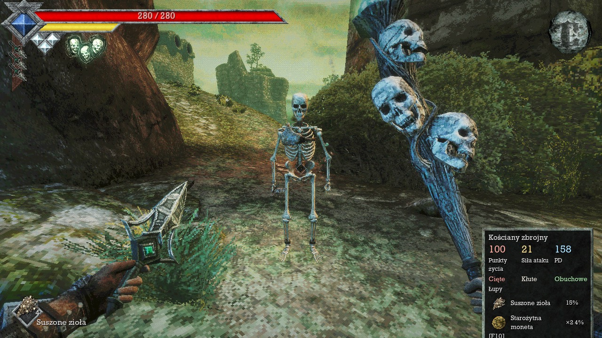

# Bestiary Lens

Version **1.0.0** — a contextual bestiary card for **Queen's Domain** (UE4SS Lua mod).

Aim at an enemy in Queen's Domain to see its unlocked bestiary information on a small card.

Runs as plain Lua scripts hosted by UE4SS. Requires the Windows game build (UE 4.27.2), UE4SS Lua support
and `LoopInGameThreadWithDelay`. Offline tests and Steam Deck (Proton) smoke testing cover loader startup, HUD construction,
native captions and F10 opening a native bestiary entry. Broader gameplay and controller coverage
is limited; native Windows behavior and other UE4SS builds are unverified.

## Install

Requires the Windows game build and a working UE4SS installation with Lua support and `LoopInGameThreadWithDelay`. The development baseline was UE4SS v3.0.1 Beta #0; other builds are unverified.

1. Download the `BestiaryLens-<version>.zip` asset from [GitHub Releases](https://github.com/rafal-zelek/bestiary-lens-queens-domain-mod/releases). If no release is listed, no release package is available there yet. Source archives are not installable packages.
2. Close the game. Find your UE4SS folder containing `UE4SS-settings.ini` and `Mods` (commonly `QueensDomain/Binaries/Win64/ue4ss`).
3. Copy `Mods/BestiaryLens` from the ZIP into that folder's `Mods` directory. Keep the empty `enabled.txt`, then launch the game normally.

## Use

Aim at an unlocked enemy. Press **F9** to toggle the card or **F10** to open its bestiary entry. Displayed stats and drop rates are base values; actual results can differ.

MIT license. Unofficial fan mod.
